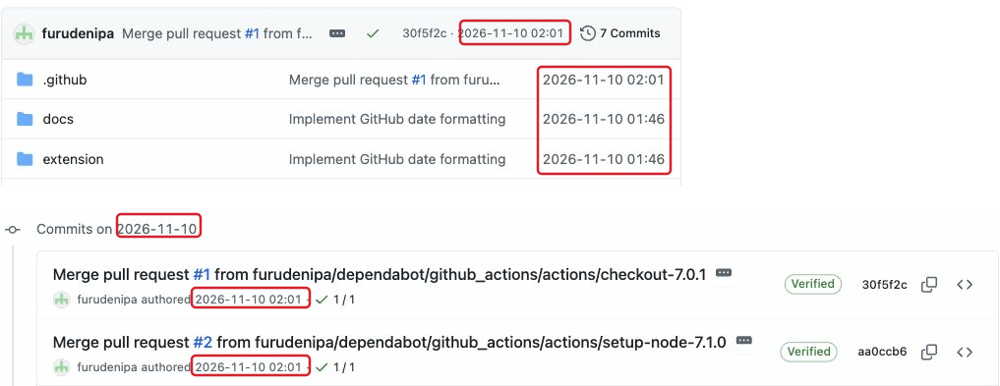

# github-datefmt

GitHub 上の相対日時・曖昧な日付表記を、わかりやすい絶対的な数値表記（YYYY-MM-DD 等）に変換する Chrome 拡張機能です。

## 主な機能

- **相対日時の変換**: 2 weeks ago などの表記を 2026-10-26 09:30 のような絶対日時に変更します。
- **日付表記の統一**: GitHub Projects などの Nov 10, 2026 を 2026-11-10 の表記に変換します。
- **タイムゾーン対応**: 時刻を含む日時はブラウザのローカルタイムゾーンで表示し、日付のみの値はそのままの年月日を維持します。
- **軽量・安全**: 設定不要で動作し、外部通信を行わず、実行時ライブラリも使用していません。
